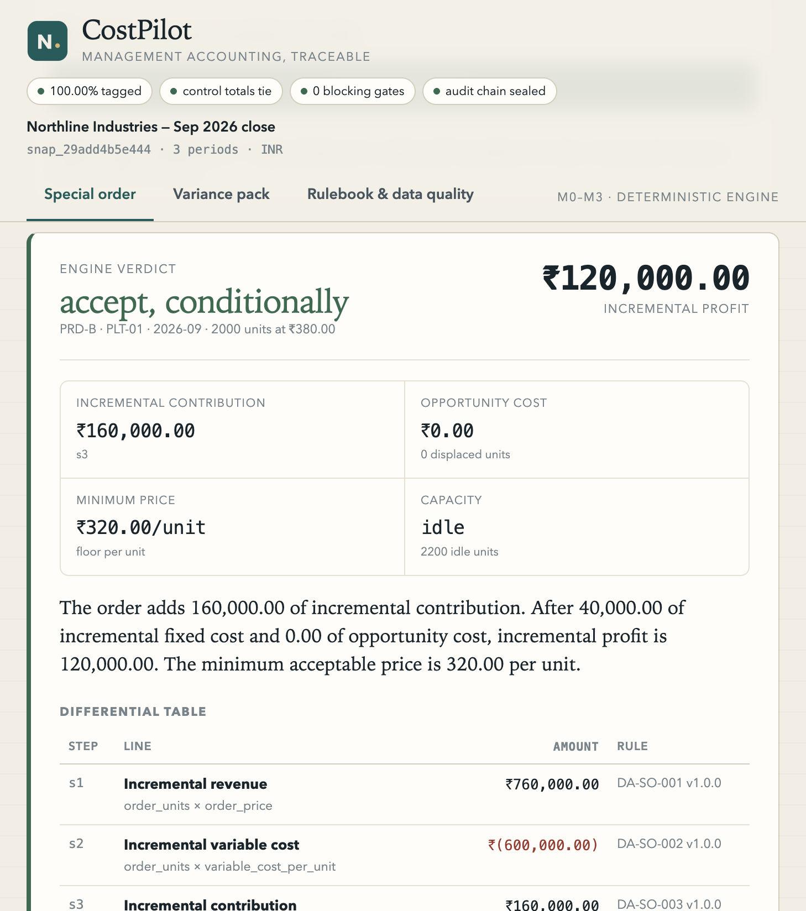

# CostPilot

A deterministic management-accounting engine with a working M0–M3 demo: a synthetic
manufacturing dataset, standard-cost variance analysis, an auditable special-order
decision, and a browser workspace that shows every calculation step.

The design rule is simple: **the language model never performs arithmetic.** Every
number comes from a rule in a versioned registry, carries its inputs and sources, and
is sealed into an append-only audit chain. There is no LLM in this repository yet;
M4 adds the planner and chat shell on top of these contracts.



## What works

| Milestone | Capability |
| --- | --- |
| M0 | Decimal-only money policy, typed trace models, versioned rule registry, slot-only narration, golden harness |
| M1 | Canonical snapshot loader, manifest hash, ten ingestion gates, account registry, capability card |
| M2 | Material/labour/overhead variances, flexible budget, account flux, absorption bridge, trace tables, audit drawer, JSON export |
| M3 | Seven decision workflows: special order, make-or-buy, add-or-drop, sell-or-process, shutdown, product mix, CVP |

Phase 1 is deliberately incomplete. The chat planner, ERP connectors, ABC/TDABC, and
budgeting workflows belong to M4 and Phase 2; see [docs/adr](docs/adr).

## Run it

All paths below are absolute so the commands work from any directory. The demo is a
local Python service; step 0 tells you whether it is already running.

**0. Check whether the service is already running.**

```bash
curl -s http://127.0.0.1:8000/api/health
```

If that prints JSON with `"ok": true`, skip to step 5. If it fails, continue.

**1. Go to the repository.**

```bash
cd /Users/adarshahebbar/Documents/CostPilot
```

**2. Activate the virtual environment.** Create it only if it does not exist.

```bash
source /Users/adarshahebbar/Documents/CostPilot/.venv/bin/activate
```

```bash
# Only when /Users/adarshahebbar/Documents/CostPilot/.venv is missing:
uv venv --python 3.13 /Users/adarshahebbar/Documents/CostPilot/.venv
source /Users/adarshahebbar/Documents/CostPilot/.venv/bin/activate
```

**3. Install the package and development tools.**

```bash
uv pip install -e "/Users/adarshahebbar/Documents/CostPilot[dev]" --python /Users/adarshahebbar/Documents/CostPilot/.venv/bin/python
```

**4. Run the engine without a server.** Three variants:

```bash
costpilot demo
costpilot check
costpilot capability
```

`demo` prints the canonical special-order trace. `check` runs the ten ingestion gates
and exits non-zero on a blocking gate. `capability` prints the dataset card as JSON.

**5. Start the workspace.** Two variants, same result:

```bash
costpilot serve --port 8000
```

```bash
python -m uvicorn costpilot.api.main:app --host 127.0.0.1 --port 8000
```

Open <http://127.0.0.1:8000>. API docs are at <http://127.0.0.1:8000/docs>.

**Variant: different fixture directory or audit database.**

```bash
costpilot serve --port 8000 --fixtures /absolute/path/to/fixtures --audit-db /absolute/path/to/audit.db
```

```bash
COSTPILOT_FIXTURES=/absolute/path/to/fixtures COSTPILOT_AUDIT_DB=/absolute/path/to/audit.db python -m uvicorn costpilot.api.main:app --port 8000
```

**6. Stop the service** with `Ctrl+C` in the terminal that started it.

## Verify

```bash
cd /Users/adarshahebbar/Documents/CostPilot
source /Users/adarshahebbar/Documents/CostPilot/.venv/bin/activate
ruff check /Users/adarshahebbar/Documents/CostPilot
pytest /Users/adarshahebbar/Documents/CostPilot/tests
```

The suite covers the canonical numbers (₹120,000 profit, ₹320 floor, ₹160,000
contribution, half-capacity case at −₹60,000 and a ₹410 floor), all seven decision
workflows, every variance formula, the ten gates, the hash chain, re-performance, and
the HTTP confirmation gate.

## API

Preview resolves inputs and names their source without calculating:

```bash
curl -s -X POST http://127.0.0.1:8000/api/tools/preview_differential_analysis \
  -H 'content-type: application/json' \
  -d '{"decision_type":"special_order","arguments":{}}'
```

Calculation requires explicit confirmation:

```bash
curl -s -X POST http://127.0.0.1:8000/api/tools/run_differential_analysis \
  -H 'content-type: application/json' \
  -d '{"decision_type":"special_order","arguments":{},"confirmation":{"confirmed":true}}'
```

Other tools: `POST /api/tools/run_variance_analysis`, `POST /api/tools/run_costing_bridge`,
`GET /api/runs/{run_id}`, `POST /api/runs/{run_id}/reperform`, `GET /api/audit/verify`.

## Layout

```
costpilot/engine/       money, trace, narration, validation, rulebook
costpilot/engine/variance/   material, labour, overhead, flexible budget, flux
costpilot/engine/decisions/  seven workflows
costpilot/engine/costing/    variable-to-absorption bridge
costpilot/data/         loader, gates, capability
costpilot/audit.py      append-only SQLite chain and re-performance
costpilot/service.py    resolution, confirmation, tool envelopes
costpilot/api/          FastAPI surface and the single-file workspace
fixtures/               deterministic Northline Industries dataset
scripts/                fixture generator
tests/                  golden corpus and regression suite
docs/                   blueprint, phase plans, white paper, ADRs
```

## The dataset

Northline Industries: three products (PRD-A, PRD-B, PRD-C), two plants (Pune, Coimbatore),
three months (Jul–Sep 2026), INR. The canonical special-order case is PRD-B at Pune in
September: 2,000 units at ₹380, variable manufacturing cost ₹300, ₹40,000 incremental
fixed cost, 2,200 idle units, regular price ₹500. Regenerate the files with:

```bash
python /Users/adarshahebbar/Documents/CostPilot/scripts/generate_fixture.py
```

The generator is deterministic. Editing any fixture file changes the snapshot ID,
because the ID is derived from the manifest hash of all files.

## Limits

- No LLM planner, chat shell, or natural-language intent extraction. The API takes
  structured arguments; the confirmation sheet is the trust boundary.
- One currency, one scarce resource per product-mix run, no FX translation.
- Account flux is level B: no price/usage split is fabricated, and the residual is
  labelled unexplained.
- Snapshots are immutable in memory but there is no snapshot store; re-ingesting a
  corrected file produces a new snapshot ID and leaves the files on disk untouched.
- The audit database is local SQLite. It is append-only by trigger, not distributed.

## Documents

- [Build blueprint](docs/CostPilot_Blueprint.pdf) — contracts, data model, rulebook, delivery gates
- [Phase 1 plan](docs/CostPilot_Phase_A_Plan.pdf) and [Phase 2 plan](docs/CostPilot_Phase_B_Plan.pdf)
- [White paper](docs/CostPilot_WhitePaper.pdf)
- [ADR 0001: trust boundary](docs/adr/0001-trust-boundary.md)
- [ADR 0002: canonical data model](docs/adr/0002-canonical-data-model.md)
